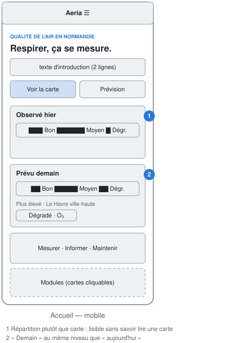
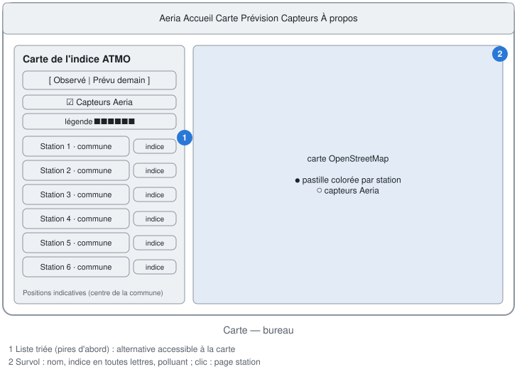
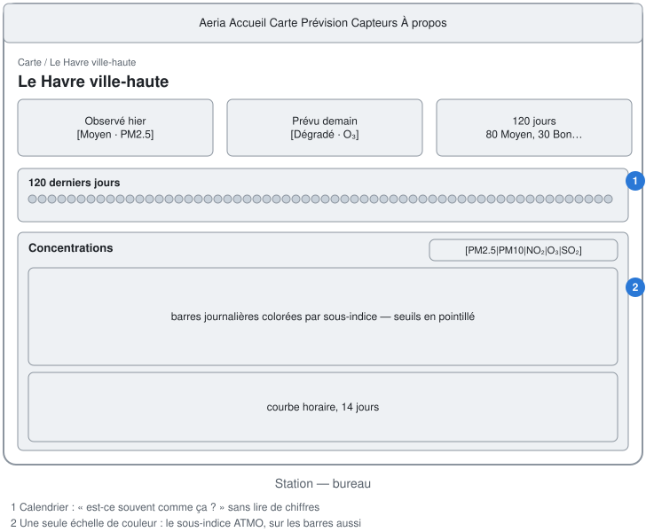

# Étude de cas UX — tableau de bord Aeria

Démarche : comprendre → définir → idéer → prototyper → évaluer. L'outil Figma n'était pas disponible pour ce
projet. Les maquettes sont des wireframes vectoriels versionnés ([`wireframes/`](wireframes)), et le
prototype haute fidélité est directement le site React, testable en ligne.

## 1. Comprendre

### Le problème

L'information sur la qualité de l'air existe : les ATMO publient un indice par commune, l'État publie les
mesures brutes. Elle répond pourtant mal à trois questions concrètes :

1. *« Est-ce que je peux faire courir mon enfant asthmatique dehors demain ? »* : il faut la **prévision**
   et la cause (ozone l'après-midi, particules le matin ?).
2. *« Quelle station près de chez moi, et pourquoi elle est orange ? »* : il faut la **localisation** et le
   polluant responsable.
3. *« Mon capteur de quartier fonctionne-t-il ? »* : il faut la **fiabilité** des mesures.

### Personas

| | Claire, 38 ans, Le Havre | Karim, 45 ans, chargé de mission environnement (mairie) | Inès, 31 ans, technicienne Aeria |
|---|---|---|---|
| Contexte | fille asthmatique, vit près du port | rend compte au conseil municipal | maintient les capteurs sur le terrain |
| Besoin | savoir **demain**, vite, sur son téléphone | comparer les stations, voir des tendances | voir l'état du parc depuis son téléphone |
| Frustration | « les sites officiels parlent de µg/m³, je ne sais pas si c'est grave » | « je reconstruis des graphiques dans Excel » | « j'apprends qu'un capteur est muet quand on m'appelle » |
| Page clé | Accueil, Prévision | Carte, Station | Capteurs Aeria (le détail est dans le back-office) |

### Parcours utilisateur de Claire (avant)

1. Elle cherche « qualité de l'air Le Havre » sur Internet.
2. Elle tombe sur l'indice de la commune pour **aujourd'hui**.
3. Elle ne trouve pas demain ou ne le comprend pas.
4. Elle décide au jugé.

Point de douleur principal : **l'information utile est dans le futur**, alors que les sites montrent le
présent.

## 2. Définir

**Énoncé** : *Claire a besoin de savoir en moins de 10 secondes si l'air de demain sera bon près de chez elle,
et pourquoi s'il ne l'est pas, sans connaître les polluants ni les unités.*

Principes retenus :

1. **Demain d'abord** : la prévision est sur l'accueil, au même niveau que l'observation.
2. **Des mots, pas que des couleurs** : chaque indice est écrit (« Dégradé »), avec son polluant.
   Environ 8 % des hommes ont une vision des couleurs atypique, et la palette ATMO officielle (cyan, vert,
   jaune, rouge) en souffre.
3. **Les couleurs officielles** : les utilisateurs connaissent déjà la palette ATMO, inventer une échelle
   brouillerait le message.
4. **Honnêteté** : les positions approximatives, les capteurs simulés et l'écart avec l'indice officiel
   communal sont signalés là où l'utilisateur les rencontre.
5. **Mobile d'abord** : Claire consulte sur son téléphone, Karim sur un écran large.

## 3. Idéer : architecture de l'information

```
Accueil ── Carte ── Station (détail)
   │         └── liste des stations triée par indice (alternative accessible à la carte)
   ├── Prévision (toutes les stations, demain)
   ├── Capteurs Aeria (parc)
   └── À propos (méthode, sources, limites)
```

Navigation plate (5 entrées) : chaque information est au plus à deux clics.

## 4. Prototyper

### Wireframes (basse fidélité)

| Accueil (mobile) | Carte (bureau) | Station (bureau) |
|---|---|---|
|  |  |  |

Décisions prises sur les wireframes :

- **Accueil** : deux barres de répartition (« observé », « prévu demain ») plutôt qu'une carte. On comprend
  d'un coup d'œil que « la majorité est Moyen, deux stations Dégradé », sans savoir lire une carte.
- **Carte** : la liste triée par indice décroissant est à côté de la carte, pas dans une fenêtre. Les pires
  stations apparaissent en premier, et la liste sert d'alternative au clavier et au lecteur d'écran.
- **Station** : bandeau calendrier de 120 jours (un carré par jour) avant les graphiques. Il répond à « est-ce
  souvent comme ça ? » sans lire de chiffres.

### Système visuel

| Élément | Choix | Raison |
|---|---|---|
| Couleurs de l'indice | palette ATMO officielle | familiarité |
| Texte sur couleur | encre foncée sur cyan, vert, jaune, rouge ; blanc sur bordeaux et violet | contraste lisible sur chaque niveau |
| Accent d'interface | bleu #2a78d6 | distinct de toute couleur de l'indice |
| Typographie | police système | rapide, lisible, sans téléchargement |
| Graphiques | barres colorées par sous-indice, lignes fines de 2 px, grille discrète, seuils en pointillé | la couleur répète l'information portée par la hauteur et l'infobulle |
| Thème sombre | suit le système | lecture le soir |

## 5. Évaluer

### Évaluation heuristique (Nielsen) du prototype

| Heuristique | Constat sur le prototype | Correction |
|---|---|---|
| Visibilité de l'état du système | l'utilisateur ne savait pas de quand dataient les données | date sur chaque titre (« Observé le mercredi 11 novembre ») et date d'export dans À propos |
| Correspondance avec le monde réel | « PM2.5 » ne parle pas à Claire | polluant en clair dans les graphiques (« Particules fines PM2.5 ») ; l'indice reste le message principal |
| Contrôle et liberté | — | fil d'Ariane sur la page station |
| Cohérence | deux échelles de couleur envisagées (indice et concentrations) | une seule échelle : le sous-indice ATMO colore aussi les barres de concentration |
| Prévention des erreurs | position des stations prise pour exacte | mention « positions indicatives » sous la liste de la carte |
| Reconnaissance plutôt que rappel | légende dans À propos seulement | légende compacte permanente sur la carte |
| Esthétique minimaliste | 6 tuiles sur la page station | 3 tuiles : observé, prévu, historique |

### Accessibilité (WCAG 2.1 AA)

- Navigation clavier complète, lien « Aller au contenu », focus visible.
- La couleur n'est jamais seule porteuse de l'information : libellé et numéro dans chaque pastille.
- Sélecteurs (période, polluant) en `role="radiogroup"`, graphiques titrés par une légende de figure.
- **Écart assumé** : la carte Leaflet n'est pas exploitable au lecteur d'écran. La liste triée offre une
  alternative équivalente.

### Test utilisateur (protocole)

Le protocole est prêt, il reste à le mener avec 5 participants correspondant aux personas.

1. « Dites-moi si l'air sera bon demain au Havre. » Mesures : temps, réussite.
2. « Quelle est la station la plus polluée aujourd'hui, et à cause de quoi ? »
3. « Cette station a-t-elle souvent un air dégradé ? »
4. Questionnaire SUS (10 questions), puis entretien libre.

Critères de succès : tâche 1 en moins de 10 secondes pour 4 participants sur 5, score SUS supérieur à 75.
